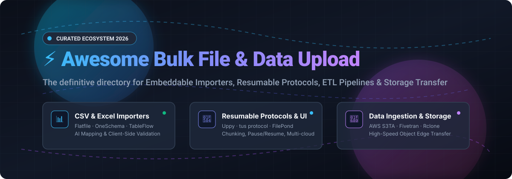

# ⚡ Awesome Bulk File & Data Upload Tool

  

  
  
  
  
  
  
  

---

## 🚀 The Bulk File & Data Upload Tool Ecosystem

> 💡 **A curated directory of SaaS platforms & open-source developer libraries for bulk file transfer, embeddable spreadsheet importers, resumable chunked upload protocols, and automated ETL/ELT pipelines.**

Whether you are building a B2B SaaS application requiring end-user CSV onboarding, configuring multi-gigabyte resumable media uploads, or moving terabytes of structured data directly into cloud object storage and data warehouses, this directory indexes both **battle-tested open-source libraries** and **enterprise hosted platforms**.

---

## 📑 Table of Contents
- [📈 Sector Overview & Market Dynamics](#-sector-overview--market-dynamics)
- [🏢 SaaS / Hosted Platforms](#-saas--hosted-platforms)
- [💻 Open-Source GitHub Projects](#-open-source-github-projects)
- [🌟 Star History](#-star-history)
- [🤝 Support & Sponsoring](#-support--sponsoring)
- [🛠️ How to Contribute](#️-how-to-contribute)
- [⚠️ Disclaimer](#️-disclaimer)

---

## 📈 Sector Overview & Market Dynamics

The global data integration, automated ingestion, and bulk file transfer market is estimated at approximately **$14 billion to $17 billion** (projected to exceed **$35 billion** by the 2030s at an ~12% CAGR). 

The market dynamics exhibit **moderate fragmentation** across developer-facing point solutions (embeddable CSV/Excel importers, media upload widgets, and headless data cleaners), while remaining **heavily concentrated** among cloud hyperscalers and dominant enterprise data movement providers for high-throughput data warehouse pipelines.

---

## 🏢 SaaS / Hosted Platforms

| Company / Product | Description | Scale (Revenue / Valuation) | Pricing (Starting Paid Tier) | Free Tier / Trial Limits |
| :--- | :--- | :--- | :--- | :--- |
| **[AWS S3 Transfer Acceleration](https://aws.amazon.com/s3/transfer-acceleration/)** | ⚡ Accelerated file transfer for S3 buckets using CloudFront edge routing over optimized AWS backbone network paths. | ~$184B annualized run rate (Amazon: ~$2.8T market cap) | $0.04/GB acceleration premium (US/EU/JP) or $0.08/GB (other regions), plus standard S3 PUT rates | AWS Free Tier provides 12 months with 5 GB storage & 2,000 PUT requests, but 0 GB free for S3TA acceleration surcharges ("no speed, no pay" guarantee) |
| **[Zoho DataPrep (Bulk Upload)](https://www.zoho.com/dataprep/)** | 🤖 AI-powered data preparation and ETL platform with 70+ connectors, visual pipeline builder, and 250+ transforms. | ~$1.5B annual revenue (~$12B–$12.5B estimated valuation) | $40/month billed annually (Standard plan, includes up to 2 million rows/month) | Free plan includes up to 20,000 rows processed/month (downgrades automatically to Free after a 15-day free trial of Standard) |
| **[Fivetran](https://www.fivetran.com/)** | 🔄 Automated data movement platform with 700+ connectors delivering into warehouses, lakes, and cloud storage. | $5.6B valuation (~$325M–$350M standalone revenue; $600M+ ARR combined post-dbt merger) | Usage-based starting at ~$500/month (Standard plan with 15-minute syncs) | Free forever plan includes up to 500,000 Monthly Active Rows (MAR), 3,500 reverse-ETL MAR, and 5,000 transformations/month (plus 14-day free trial for new connectors) |
| **[Cloudinary Upload Widget](https://cloudinary.com/documentation/upload_widget_reference)** | 🖼️ Embeddable media upload widget with client-side cropping, multi-source ingestion, and automated transformation. | $2.0B valuation (~$100M+ ARR) | $89/month billed annually or $99/month billed monthly (Plus plan, includes 225 credits/month) | Free plan includes 25 monthly credits (~25,000 transformations, 25 GB storage, or 25 GB bandwidth) for up to 3 users |
| **[Flatfile](https://flatfile.com/)** | 📋 AI-powered data onboarding platform embedding CSV/Excel import workflows directly into web products. | $185M valuation (~$94M total funding raised, ~$11M estimated ARR) | $799/month (Professional tier with SAML SSO, white-labeling, and DPAs) | Free Starter tier includes up to 50 files and 10 million Processed Data Values (PDVs) per month (capped at 10,000 records per API extraction call) |
| **[OneSchema](https://www.oneschema.co/)** | 📑 Embeddable spreadsheet importer with AI mapping, bulk error-fixing, and sub-second validation up to 4 GB. | $6.4M funding raised (~$3M estimated ARR) | $20/month (Starter self-serve plan with baseline monthly credits) | Free forever tier includes 4,000 free processing credits for validation and spreadsheet imports (additional usage at ~$0.012/credit) |
| **[Filestack](https://www.filestack.com/)** | 📦 File upload, transformation, and storage routing API with direct uploads to S3, GCS, and Azure. | Acquired by Idera, Inc. ($1.95M prior VC funding, ~$2.1M ARR at acquisition) | $69/month (Start tier, includes 10,000 uploads and 50 GB bandwidth) | Free plan includes 500 uploads, 1 GB storage, 1 GB bandwidth, and 1,000 transformations per month (max file size 20 MB) |
| **[Transloadit](https://transloadit.com/)** | ⚙️ File processing & upload platform supporting tus resumable protocol and encoding pipelines; powers Uppy. | ~$1.3M–$1.4M estimated ARR (Self-funded / Bootstrapped) | $29/month (Lite plan, includes 15 GB processing per month; extra usage at $2/GB) | Free Community tier includes 5 GB processing per month, 500 MB max file size, with watermarked images and trimmed audio/video outputs |
| **[Dromo](https://dromo.io/)** | 🛡️ Embeddable and headless CSV/Excel importer with AI column mapping and client-side zero-retention mode. | Early-stage VC-backed (~$1M+ estimated ARR) | $399/month billed annually or $499/month billed monthly (Professional plan) | 14-day free trial with full developer access and up to 250 test imports per month |
| **[CSVbox](https://csvbox.io/)** | 📥 Embeddable CSV/Excel importer widget with AI mapping, real-time validation, and 20+ destination sinks. | Bootstrapped / Unfunded (<$1M estimated ARR) | $19/month (Startup tier, includes up to 1,000 imports per month with 10,000 rows/import) | Free Sandbox tier includes 100 imports/month with up to 5 rows per import, 5 AI doc import pages, and 3 team members |

---

## 💻 Open-Source GitHub Projects

Sorted by GitHub Stars_Count in descending order:

1. **[Rclone](https://github.com/rclone/rclone)**   
   🌐 The "rsync for cloud storage" — high-performance CLI utility to sync, transfer, and bulk upload files to and from 70+ cloud storage providers (S3, Google Drive, Azure Blob, Dropbox, SFTP, WebDAV) with multi-threaded streaming, bandwidth limits, chunking, and resume capabilities.

2. **[Uppy](https://github.com/transloadit/uppy)**   
   🐶 Modular, extensible JavaScript file uploader for web browsers. Seamlessly handles file picking from local disk, Google Drive, Dropbox, Box, Instagram, and webcams, with robust chunked resumable uploads via the open `tus` protocol and direct-to-S3 multipart upload support.

3. **[jQuery-File-Upload](https://github.com/blueimp/jQuery-File-Upload)**   
   📁 Veteran, ubiquitous file upload widget featuring multiple file selection, drag-and-drop support, progress bars, validation, image/video previews, chunked file slicing, and cross-domain resumable uploads.

4. **[Dropzone](https://github.com/enyo/dropzone)**   
   🎯 Lightweight, dependency-free JavaScript library providing smooth drag-and-drop file uploads with instant image previews, customizable event hooks, and automated progress tracking.

5. **[FilePond](https://github.com/pqina/filepond)**   
   🌊 Silky-smooth, highly customizable JavaScript upload library with native plugins for image optimization, client-side EXIF correction, automatic file encoding, chunked file uploads, and adapters for React, Vue, Svelte, and Angular.

6. **[Fine Uploader](https://github.com/FineUploader/fine-uploader)**   
   📤 Comprehensive client-side file upload library supporting direct-to-cloud uploads (Amazon S3 and Azure Blob), chunking, pausing, auto-retrying failed chunks, and image previews.

7. **[tusd](https://github.com/tus/tusd)**   
   ⚡ The official reference server implementation in Go for `tus` — an open protocol for resumable file uploads over HTTP. Scales to millions of connections and seamlessly streams chunks into AWS S3, Google Cloud Storage, Azure Blob, or local disks.

8. **[Chibisafe](https://github.com/chibisafe/chibisafe)**   
   🚀 Blazing fast open-source TypeScript file vault and upload service featuring chunked uploads for large multi-gigabyte files, S3-compatible backend storage, public/private sharing links, albums, and ShareX integration.

9. **[tus-js-client](https://github.com/tus/tus-js-client)**   
   🔌 Pure JavaScript client implementation of the `tus` resumable upload protocol. Operates smoothly in browser environments, Node.js, React Native, and Web Workers.

10. **[TableFlow CSV Import](https://github.com/tableflowhq/csv-import)**   
    📊 Modern open-source CSV and spreadsheet import component for web applications. Features automated column mapping, custom data validation, row sanitization, and seamless React integration.

11. **[csv-importer (Ruby)](https://github.com/pcreux/csv-importer)**   
    💎 Declarative CSV data import framework for Ruby and Ruby on Rails with fuzzy header matching, row-level validation, and error reporting.

12. **[DumbDrop](https://github.com/DumbWareio/DumbDrop)**   
    📦 Minimalist self-hosted file dropper service with configurable storage directories, PIN protection, and reverse-proxy compatibility for lightweight file collection.

13. **[react-csv-importer](https://github.com/beamworks/react-csv-importer)**   
    ⚛️ Drop-in React UI component containing a complete CSV parser, user-driven interactive column mapper, and client-side data preview step.

14. **[ImportCSV](https://github.com/importcsv/importcsv)**   
    📑 React component for CSV imports with automatic column mapping; Local Mode runs entirely in the browser (virtual scrolling up to 100,000 rows) and Backend Mode adds AI-powered transformation.

15. **[tuspyserver](https://github.com/edihasaj/tuspyserver)**   
    🐍 Lightweight FastAPI router implementing the `tus` resumable protocol with chunked storage, expiration lifecycles, and dependency injection hooks for custom auth and validation.

16. **[budibase-csv-import](https://github.com/mjashanks/budibase-csv-import)**   
    🧩 Budibase UI component for end-user CSV ingestion directly into internal Budibase tables or SQL databases.

17. **[DataPorter](https://github.com/SerylLns/data_porter)**   
    🚂 Mountable Rails engine for CSV, XLSX, and JSON imports with interactive column mapping, dry-run validations, ActionCable progress streaming, and bad-row export.

18. **[File Server (snoggin-io)](https://github.com/snoggin-io/file-server)**   
    🧪 Simple Node.js file upload microserver with a clean web UI and REST API (`POST /upload`) for rapid testing and dev ingestion setups.

---

## 🌟 Star History

---

## 🤝 Support & Sponsoring

Thank you for visiting and supporting this ecosystem directory! If you find this curated list valuable for your projects or architecture planning, please consider:

- ⭐ **Starring** the repository on GitHub to help other engineers discover it.
- 🍴 **Forking** the repo and contributing additional tools, importers, or benchmarks.
- 📢 **Sharing** with fellow developers, platform architects, and data engineering teams.
- ☕ **Buying a coffee or becoming a sponsor** via the [GitHub Sponsors Dashboard](https://github.com/sponsors/ishandutta2007) to help support continuous curation and updates!

---

## 🛠️ How to Contribute

We welcome contributions from the community! To suggest a new tool or update an existing entry:

1. 🍴 Fork the repository.
2. ✍️ Add or update entries in `README.md` (keep descriptions concise, objective, and link directly to official sites or repositories).
3. 🧪 Verify that all links are active and accurate.
4. 🚀 Submit a Pull Request describing your changes.

---

## ⚠️ Disclaimer

- This list is community-curated for informational purposes and does not represent an endorsement.
- When configuring bulk data ingestion, ensure proper rate-limiting, authentication, file type validation (MIME checking), and antivirus/malware scanning on upload endpoints.
- Self-hosted file systems should always configure lifecycle cleanup policies, disk storage quotas, and private access controls.

---

  <b>Built for SaaS architects, platform engineers, and data teams.</b> 
  Let's make file and data uploads resilient, resumable, and high-performance.

